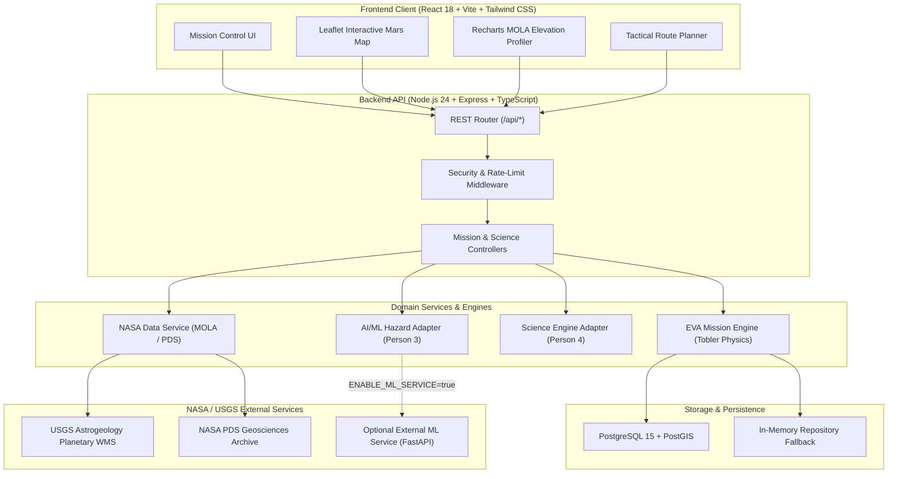

# 🪐 Martian Map

## Planetary Mission Intelligence Under Uncertainty

[](https://www.spaceappschallenge.org/)
[](https://www.typescriptlang.org/)
[](https://react.dev/)
[](https://nodejs.org/)
[](https://leafletjs.com/)
[](#-automated-testing--validation)
[](LICENSE)

> **Martian Map is a reproducible planetary mission digital twin that combines terrain intelligence, multi-agent operations, sensor uncertainty, communication modeling, safety invariants, human authorization, cryptographic mission auditing, deterministic replay, and what-if decision analysis.**

```text
OBSERVE
   ↓
UNDERSTAND
   ↓
COMPARE
   ↓
AUTHORIZE
   ↓
  ACT
   ↓
 AUDIT
   ↓
REPLAY
   ↓
WHAT-IF
```

### 🚀 Direct Evaluation Portals
- [▶ Launch Judging Demo](http://localhost:5173/demo)
- [▶ Mission Replay](http://localhost:5173/replay)
- [▶ Mission Analytics](http://localhost:5173/mission-analytics)
- [▶ Methodology & Provenance](http://localhost:5173/methodology)

---

## 🎯 The Real-World Challenge

Human extravehicular activity on Mars presents extreme, interconnected operational challenges:

1. **Hostile & Varied Topography**: High-gradient volcanic scarps, loose regolith ripples, and boulder fields severely impact astronaut mobility and suit integrity.
2. **Scattered High-Value Science**: Prime geological targets—ancient lake delta foresets, phyllosilicate clay beds, and hydrothermal mineral deposits—are distributed unevenly across planetary expanses.
3. **Rigid Life-Support Constraints**: Spacesuit consumables (pressurized oxygen reserves, thermal cooling water, and carbon dioxide scrubbers) place strict upper bounds on traversal duration. NASA flight rules dictate a minimum **30-minute safety return margin**.
4. **Data Fragmentation**: Planetary scientists and mission planners often work with disconnected tools for orbital imaging, laser altimetry, in-situ rover logs, and hazard modeling.

---

## 💡 The Solution

**Martian Map** synthesizes multi-mission NASA orbital and in-situ datasets into a unified mission operations console:

```text
Explore Mars
    ↓
Inspect Location
    ↓
Evaluate Terrain
    ↓
Discover Science Targets
    ↓
Build Marswalk
    ↓
Calculate Route
    ↓
Analyze Elevation
    ↓
Evaluate EVA
    ↓
Generate Mission Score
```

Every step flows naturally: clicking an outcrop inspects its stratigraphy, adds it as an intermediate waypoint, automatically recalculates great-circle traversal vectors, profiles laser altimetry elevations, and evaluates physiological feasibility against flight rules.

---

## 🚀 Try the Demo

Judges and evaluators can launch the fully integrated application in under two minutes:

### 1. Clone & Install

```bash
git clone https://github.com/kharbashpriyanshu/NASA-Space-Challenge.git
cd NASA-Space-Challenge
npm install
```

### 2. Start Development Servers

```bash
# Terminal 1: Backend Mission Engine (Port 5000)
npm run dev:backend

# Terminal 2: Frontend Mission Control UI (Port 5173)
npm run dev:frontend
```

Open your browser to: **[http://localhost:5173](http://localhost:5173)**

### 3. Launch the Demo Scenario (`MARSWALK-001`)

Click the **LAUNCH DEMO (MARSWALK-001)** button in the hero banner or navbar. This automatically pre-loads and calculates our flagship science traverse in **Jezero Crater**:

```text
Octavia E. Butler Landing Site (Jezero Crater Floor Base)
        ↓  [Leg 1: 0.98 km • Crossing crater floor basalt unit Máaz]
South Séítah Olivine Cumulate Core Outcrop (Magmatic basement sample target)
        ↓  [Leg 2: 1.74 km • Delta scarp ascent and boulder traversal]
Kodiak Butte Gilbert-Type Delta Remnant (Ancient lacustrine sediment outcrop)
        ↓  [Leg 3: 1.42 km • Return traverse along delta apron]
Delta Scarp Base Camp (Destination Outpost)
```

- **Inspect Topography**: View continuous elevation gain/loss and slope gradient on the interactive MOLA cross-section.
- **Assess Life Support**: Click **ASSESS EVA & MISSION SCORE** to view oxygen depletion, return safety margin, and risk scoring.
- **Tune Mission Parameters**: Adjust duration limits (from 2.0 to 6.0 hours), toggle traverse modes, or enforce round-trip returns to witness live safety recalculations.

---

## 🌟 Key Capabilities

### 🗺️ Interactive Mars Map (`/map`)
- **Planetographic Geodesy**: Spherical coordinates ($[-85^\circ, +85^\circ]$ latitude, $[-180^\circ, +180^\circ]$ longitude) centered on standard Mars cartographic conventions.
- **Multi-Layer WMS Basemaps**:
  - **USGS Viking MDIM 2.1**: Calibrated global visible-band mosaic (~232 m/pixel).
  - **MGS MOLA Topography**: Color-shaded laser altimetry digital elevation model.
  - **2001 Mars Odyssey THEMIS Day IR**: 100 m/pixel thermal infrared mosaic indicating surface rock abundance and thermal inertia.
- **Tactical Navigation**: Quick sector teleports to landmark sites: *Jezero Crater*, *Gale Crater*, *Olympus Mons*, and *Valles Marineris*.
- **Interactive Segment Overlay**: Clickable route segments displaying leg distance, average slope, and traversal duration.

### 🔬 Location Reconnaissance & "Science Along the Way"
- **Location Inspector**: Instant elevation query relative to the Mars areoid datum ($R = 3396.19\text{ km}$), slope index, geological unit classification, and verified NASA mission logs.
- **Direct Waypoint Actions**:
  - `[SET AS START]`: Designates origin base.
  - `[SET AS DEST]`: Designates mission destination.
  - `[ADD SCIENCE STOP]`: Inserts an intermediate outcrop into the active EVA path.
  - `[PLAN MISSION]`: Generates a traversable route.
- **Science Target Catalog (`/science`)**: Comprehensive inventory of astrobiological, stratigraphical, and mineralogical targets calibrated against Mars 2020 (Perseverance) and MSL (Curiosity) discoveries.

### 📈 MOLA Elevation Profiling & Terrain Analytics
- **Continuous Cross-Section**: SVG area chart sampling elevations at high-frequency increments along great-circle segments.
- **Slope Hazard Warnings**: Highlights steep scarp sections ($>15^\circ$) that present slip and regolith shear hazards.
- **Bidirectional Map Synchronization**: Hovering over any point on the elevation chart renders a synchronized reticle pin on the map surface.

### 🛡️ Deterministic EVA Feasibility & Metabolic Physics
- **Adapted Tobler Metabolic Curve**: Walking pace calculated as a function of Martian surface gravity ($0.38g$) and suit encumbrance:
  $$V(\text{slope}) = 3.2 \cdot \exp(-3.2 \cdot |\tan(\text{slope}) + 0.04|) \quad [\text{km/h}]$$
- **NASA Flight Rules Enforcement**: Calculates return travel time and enforces a mandatory **30-minute safety return margin**.
- **Life-Support Reserves**: Models metabolic oxygen consumption ($0.95\text{ L/min}$ adjusted for slope stress) relative to suit capacity.

### 🧠 Mission Decision Intelligence & Route Copilot (Phase 2)
- **Multi-Objective Candidate Optimization**: Evaluates 4 distinct route candidates for any target destination:
  - **Direct Shortest Traverse**: Minimizes travel distance and metabolic consumption.
  - **Low-Hazard Valley Corridor**: Bypasses steep scarps and loose talus slopes ($<12^\circ$).
  - **Multi-Target Science Survey**: Prioritizes in-situ sample diversity across multiple geologic units.
  - **Optimal Science & Margin Traverse**: Pareto trade-off balancing high science score ($>90$) while maintaining an emergency return buffer ($>30\text{ min}$).
- **Mars Hazard Engine**:
  - Spatial detection of documented structural hazards (Jezero Delta Front Scarp, Belva Rim Megabreccia, Neretva Fluvial Breach, Gediz Vallis Ridge).
  - Dynamic slope hazard detection ($>18^\circ$ flagged as `CRITICAL`, $>12^\circ$ as `HIGH`).
  - Actionable mitigation recommendations (standoff distance, switchback cadence, cooling pauses).
- **Explainable Reasoning & Directives**:
  - Authoritative decision summary detailing why the route was chosen over alternatives.
  - Transparent comparison showing delta distance, delta science return, and margin impacts.
  - Explicit operational directives for astronaut safety.
- **Cybersecurity Audit Logging**:
  - Every route generation, optimization, and recommendation event is recorded with an immutable **SHA-256 integrity hash**.

### 🤖 Unified Mission Score (Person 3 Adapter)
- **Multi-Factor Evaluation**:
  - **Safety Score (45%)**: Penalties for excessive incline, distance, and duration.
  - **Science Yield (35%)**: Weighted by number of cataloged sampling targets visited.
  - **Accessibility Score (20%)**: Traversal difficulty and metabolic exertion.
- **Transparent Provenance**: Scores are explicitly tagged as `rule-based` or `model-generated` (never disguising deterministic fallbacks as live AI).

### 🤖 Multi-Agent Planetary Field Operations & Teleoperations (Phase 4)
- **Planetary Multi-Agent Framework (`/operations`)**: Real-time coordinated field console tracking:
  - **ASTRONAUT-01**: Lead Human Crew Explorer with metabolic life-support reserves and corridor priority.
  - **ROVER-01 SCOUT**: High-speed reconnaissance rover with forward-facing laser altimetry and Hazcam arrays.
  - **ROVER-02 SCIENCE**: Heavy astrobiology rover equipped with Deep UV Raman Spectrometer and Abrasion Core Drill.
  - **ROVER-03 RELAY**: Tactical communications node positioned on elevated topography with a 12 km UHF mast.
  - **ORBITER-01 (MRO-Relay)**: 320 km sun-synchronous orbiter providing high-bandwidth (2048 kbps) passes every 112 minutes.
- **Autonomous Rover Control Loop**: 9-stage closed-loop operational cycle (`OBSERVE` $\to$ `ASSESS` $\to$ `SELECT TASK` $\to$ `PLAN PATH` $\to$ `CHECK BATTERY` $\to$ `CHECK COMMS` $\to$ `CHECK HAZARDS` $\to$ `EXECUTE/PAUSE` $\to$ `REPORT`).
- **Safe-Return Energy Feasibility**: Enforces continuous 20% battery reserve margin; automatically rejects unfeasible long-range traverses.
- **Chord Line-of-Sight & Topographical Ray-Tracing**: Physics-grounded radio link assessment incorporating Mars planetary curvature ($R_{\text{Mars}} = 3396.19\text{ km}$) and intervening MOLA relief.
- **Dynamic Replanning Engine**: Automated detour generation triggered upon detecting excessive terrain slope or communication loss; includes quantitative trade-off synthesis ($\Delta\text{ Distance}$, $\Delta\text{ Safety}$, $\Delta\text{ Duration}$) with Mission Command authorization gates.
- **Collaborative Operations Copilot**: Natural-language operations guidance reasoning over live agent telemetry, slope hazards, and scientific targets.
- **Flagship Demo**: 1-click end-to-end execution of the Scout rover hazard encounter, autonomous pause, detour recommendation, and Flight Director approval workflow.

### 🪐 Planetary Digital Twin, Replay & Validation Engine (Phase 6)
- **Digital Twin Mission Replay (`/replay`)**:
  - Reconstructs exact historical states from an immutable, cryptographic event ledger.
  - Interactive playback scrubber, forward/backward stepping, and 0.5x–10x speed controls.
  - Read-only decoupling ensures historical replay never pollutes live operational state.
- **What-If Decision Branching & Delta Comparison**:
  - Clones mission state at any timeline point to evaluate alternative decisions (e.g., `IGNORE_HAZARD` vs `DETOUR_VALLEY`).
  - Delivers an 8-dimension quantitative comparison (Distance, Duration, Battery Reserve, Science Yield, Comms Reliability, Composite Safety, Hazards Avoided, Mission Outcome).
- **Seeded Monte Carlo Uncertainty Engine**:
  - 100-run stochastic simulation using a seeded LCG (Seed `20261107`) and Box-Muller transforms.
  - Computes percentile distributions for battery margins (P10: 71.2%, P50: 78.4%, P90: 84.6%), traversal duration, comm outage probabilities (12.0%), and mission success rate (98.0%).
- **Failure Injection & Resilience Harness**:
  - Deliberately injects 6 realistic fault modes (`SENSOR_DEGRADED`, `BATTERY_DRAIN`, `COMMUNICATION_BLACKOUT`, `ROVER_IMMOBILIZED`, `HAZARD_APPEARS`, `ASTRONAUT_COMMS_LOST`).
  - Verifies automated mitigations and locks events into the tamper-evident SHA-256 audit ledger.
- **Automated S1–S8 Safety Invariant Suite**:
  - Continuous runtime validation of power reserves, vehicle slope limits, crew life-support consumables, blackout limits, latency speeds, astronaut proximity, soil sinkage, and cyber command replay/TTL limits.
- **Transparent Health Model & Mission KPI Analytics (`/mission-analytics`)**:
  - Decomposes mission health score (89/100) into 7 weighted, explainable components.
  - Aggregates operations, communication, science return, and safety metrics.
- **7-Step Decision Explanation Lineage & Provenance Explorer**:
  - Graph visualization showing the causal chain: Sensor Observation $\to$ Hazard Classification $\to$ Invariant Check $\to$ Pareto Routes $\to$ Copilot Synthesis $\to$ Human Authorization $\to$ Autonomous Execution.
  - Deep provenance registry exposing NASA PDS dataset IDs, processing pipelines, and 95% confidence intervals.
- **NASA Judging Demo Console (`/demo`)**:
  - 4 one-click evaluation scenarios (`MARSWALK-001`, `COMM-BLACKOUT-001`, `SENSOR-HAZARD-001`, `EMERGENCY-001`) with structured 5-point judge reports.

### 🚀 Advanced NASA Challenge Capabilities
- **Dynamic Regional Dust Storm Hazard Simulator**:
  - 1-click storm trigger modeling atmospheric optical depth ($\tau = 2.45$), $65\%$ solar array output drop, and automated long-leg ($>1.2\text{ km}$) exposure alerts.
  - A* pathfinding router dynamically penalizes high-altitude exposed ridges ($>-2500\text{ m}$) and directs rovers/astronauts into sheltered canyon corridors.
- **Aerospace-Grade Mission Briefing Dossier (Printable PDF & Markdown)**:
  - Generates an executive briefing sheet with NASA Flight Directorate header, SHA-256 cryptographic audit verification, MOLA altimetric cross-section SVG chart, consumables depletion curve, and PDS dataset provenance citations.
  - Includes a one-click "Print / Save PDF" (`@media print`) and markdown export.
- **NASA MEPAG (Mars Exploration Program Analysis Group) Science Badges**:
  - Color-coded badges mapping every outcrop to official NASA science objectives: Goal I (Life & Biosignatures), Goal II (Climate History), Goal III (Crustal Geology & Volcanism), and Goal IV (Human Exploration).
- **Simulated 2.5D Orbit-to-Ground Route Flyover & Tactical Reconnaissance HUD**:
  - Replicates NASA Space Apps Challenge Resource 3 (Curiosity lower Mount Sharp flyover).
  - Smoothly tracks traversals with a dynamic CSS 3D perspective viewport, flight attitude indicators, pitch ladder ($-75^\circ$ down to $-32^\circ$), radar altimeter ($180\text{ km} \to 650\text{ m}$), true heading azimuth, and target formation callouts.

---

## 🏛️ System Architecture



### Team Integration Boundaries

The application is structured with clean modular interfaces for specialized domain roles:

| Module | Owner / Role | Integration Boundary File | Status |
|--------|--------------|---------------------------|--------|
| **Core Full-Stack & GIS** | Person 1 (Lead Software) | `frontend/`, `backend/src/` | **Implemented & Live** |
| **Cybersecurity** | Person 2 (Security) | `backend/src/middleware/securityMiddleware.ts` | **Integration-Ready Hooks** |
| **AI / Data Science** | Person 3 (Machine Learning) | `backend/src/services/ml/mlEngineAdapter.ts` | **Integration-Ready + Baseline Model** |
| **Planetary Science** | Person 4 (Geology Domain) | `backend/src/services/science/scienceEngineAdapter.ts` | **Integration-Ready + Regional Rules** |

---

## 📊 NASA Data Sources & Provenance Classification

We maintain strict scientific transparency regarding data provenance (`DataMode = "LIVE" | "CACHED" | "BENCHMARK" | "FALLBACK" | "DEMO"`):

| Data Product | NASA Mission / Source | Classification | Operational Role |
|--------------|-----------------------|----------------|------------------|
| **MOLA MEGDR** | Mars Global Surveyor (MGS) | `Real External Data` | Surface elevation relative to areoid datum ($R=3396.19\text{ km}$). |
| **HiRISE Stereo DTM** | Mars Reconnaissance Orbiter (MRO) | `Benchmark Ground Truth` | Sub-meter localized digital terrain models for Jezero and Gale. |
| **Viking MDIM 2.1** | Viking Orbiters 1 & 2 / USGS | `Real External Data` | Calibrated visible basemap tile layer (~232 m/pixel). |
| **THEMIS Day IR** | 2001 Mars Odyssey / ASU | `Real External Data` | Global thermal infrared mosaic indicating rock abundance and thermal inertia. |
| **Rover Traverses & Targets** | Mars 2020 & MSL / PDS Analyst's Notebook | `Benchmark Ground Truth` | In-situ observations and ground-truth sample logs (SuperCam, CheMin, PIXL). |
| **MOLA Elevation Cross-Section** | Martian Map Mission Engine | `Derived Calculation` | Great-circle surface sampling interpolated at ~300 m resolution. |
| **Metabolic Traversal Pace** | Martian Map Mission Engine | `Derived Calculation` | Tobler hiking speed calibrated for Martian gravity ($0.38g$). |
| **Life Support Reserves** | NASA Flight Rules Model | `Deterministic Heuristic` | Enforces mandatory 30-min return margin & metabolic $O_2$ consumption. |
| **Evidence-Based Scarps** | Regional Geologic Mapping | `Derived / Evidence-Backed` | Slope gradient and scarp boundary visualization with sensor citations. |
| **Factorized Science Scoring** | MEPAG / Mars Science Community | `Project Scoring Rule` | Separates physical observed evidence from mission scoring weights. |

---

## 📚 Planetary Mission Documentation & Architecture

### Phase 7: Mission Readiness, Scientific Verification & Judge Hardening
- [Phase 7 Master Claim Audit & Classification](docs/PHASE7_CLAIM_AUDIT.md)
- [Phase 7 Closed-Loop Architecture](docs/PHASE7_ARCHITECTURE.md)
- [Why Martian Map — Strategic & Scientific Differentiation](docs/WHY_MARTIAN_MAP.md)
- [Documented Scientific Limitations & Model Boundaries](docs/SCIENTIFIC_LIMITATIONS.md)
- [Automated Verification Matrix (S1–S8, Security, Replay, What-If)](docs/PHASE7_VERIFICATION_MATRIX.md)
- [Clean Machine Installation Guide](docs/CLEAN_INSTALL.md)
- [Official 5-Minute Judge Demo Script & Narration](docs/FINAL_5_MINUTE_DEMO.md)
- [Phase 7 Final Completion Report](docs/PHASE7_COMPLETION_REPORT.md)

### Phase 6: Digital Twin, Validation & Replay
- [Phase 6 Architecture Specification](docs/PHASE6_ARCHITECTURE.md)
- [Mission Replay Model & Decoupled State](docs/MISSION_REPLAY_MODEL.md)
- [What-If Decision Branching & Delta Comparison](docs/WHAT_IF_SIMULATION.md)
- [Seeded Monte Carlo Uncertainty Analysis](docs/MONTE_CARLO_MODEL.md)
- [Failure Injection Engine & Testing Harness](docs/FAILURE_INJECTION.md)
- [7-Step Decision Explanation Lineage Graph](docs/DECISION_LINEAGE.md)
- [Data Provenance & Truthfulness Registry](docs/PROVENANCE_MODEL.md)
- [Mission KPI Analytics & Health Breakdown](docs/MISSION_ANALYTICS.md)
- [Phase 6 Demo & NASA Judging Guide](docs/PHASE6_DEMO.md)
- [Phase 6 Completion Report](docs/PHASE6_COMPLETION_REPORT.md)

### Phase 3–5 Foundations
- [Data Architecture & Planetary Grounding](docs/DATA_ARCHITECTURE.md)
- [Data Provenance & Trust Model](docs/PROVENANCE.md)
- [Observational Uncertainty & Mathematical Decision Formulation](docs/UNCERTAINTY_MODEL.md)
- [Cybersecurity, RBAC & Persistent SHA-256 Audit Chain](docs/SECURITY_ARCHITECTURE.md)
- [Mission Copilot Reasoning & Natural Language Parsing](docs/COPILOT_REASONING.md)

---

## 🧪 Automated Testing & Validation

The codebase includes comprehensive unit, mathematical, and end-to-end integration test coverage executed via **Vitest** and **Supertest**:

```bash
npm test
```

### Test Suite Results: 256 / 256 Passing (100%) Across 51 Test Files

- `tests/backend/missionReplay.test.ts` (4 tests):
  - Initializes replay cursor and loads chronological mission event stream.
  - Reconstructs accurate digital twin state without mutating live operational stores.
  - Steps forward and backward through event timeline while adjusting metrics.
  - Seeks to simulation timestamps and applies event type filters.
- `tests/backend/whatIfSimulation.test.ts` (4 tests):
  - Clones mission state at fork simulation time into an isolated sandbox.
  - Simulates alternate branch with mutated decisions (e.g., `IGNORE_HAZARD`).
  - Generates 8-dimension structured delta comparison against baseline.
  - Guarantees live operational state remains unmodified during simulation.
- `tests/backend/safetyValidationPhase6.test.ts` (6 tests):
  - Invariant S1–S8 automated validation against active mission logs.
  - Flags mission status as `INVALID` upon detecting safety invariant violations.
  - Computes transparent mission health score breakdown (7 weighted components).
  - Enforces command replay prevention and 300-second TTL limits (S8).
  - Verifies command nonce and timestamp persistence across server restarts.
  - Validates seeded 100-run Monte Carlo uncertainty distributions.

- `tests/backend/marsCoordinates.test.ts` (5 tests):
  - Validates Martian latitude $[-90^\circ, +90^\circ]$ and longitude $[-180^\circ, +360^\circ]$.
  - Normalizes planetary longitude to standard $[-180^\circ, +180^\circ]$ format.
  - Great-circle distance accuracy based on Mars radius ($R = 3389.5\text{ km}$).
  - Incline slope calculation from horizontal run and elevation delta.
  - Bounding box spatial containment.
- `tests/backend/terrainEngine.test.ts` (3 tests):
  - Point terrain assessment with dynamic confidence and uncertainty bounds.
  - Segment profile elevation differential and traversal classification.
  - Surface roughness derivation from elevation standard deviation.
- `tests/backend/hazardEngine.test.ts` (3 tests):
  - Catalog retrieval of documented geological hazards with supporting evidence.
  - Proximity detection near Jezero Delta Scarp.
  - Dynamic critical slope trigger when incline exceeds 18°.
- `tests/backend/scienceObjectiveEngine.test.ts` (3 tests):
  - MEPAG exploration objectives mapping.
  - Objective-to-target relevance evaluation.
  - Multi-target science route yield scoring.
- `tests/backend/factorizedScience.test.ts` (2 tests):
  - Factorized science scoring separating observed physical evidence from project rules.
  - In-situ rover verification bonuses and sample diversity multipliers.
- `tests/backend/planetaryData.test.ts` (3 tests):
  - Multi-tier MOLA altimetry fallback and benchmark resolution.
  - Planetary data coverage engine across 5 sensor dimensions.
  - Bounded in-memory LRU cache TTL and hit/miss behavior.
- `tests/backend/paretoOptimization.test.ts` (1 test):
  - Multi-objective Pareto non-domination computation.
- `tests/backend/securityPhase3.test.ts` (3 tests):
  - HMAC-SHA256 JWT token generation and verification.
  - RBAC permission enforcement across 5 operational roles.
  - Persistent SHA-256 audit block chain integrity verification.
- `tests/backend/routeOptimization.test.ts` (2 tests):
  - Generates 4 differentiated candidate profiles (shortest, safest, highest science, balanced).
  - Validates bounded scores and feasibility verification.
- `tests/backend/missionReasoning.test.ts` (1 test):
  - Structured, explainable recommendation with SHA-256 audit hash.
- `tests/backend/missionEngine.test.ts` (6 tests):
  - Deterministic route generation with elevation profile and segment legs.
  - Multiple science stops dwell-time buffer calculations.
  - EVA feasibility verification under 240-minute constraints.
  - Detection and warning for duration limit overruns.
  - Detection of low return safety margin ($<30\text{ min}$).
  - Error handling for invalid single-point routes.
- `tests/backend/apiEndpoints.test.ts` (9 tests):
  - `GET /` system health check.
  - `GET /api/locations` benchmark planetary catalog.
  - `GET /api/locations/:id` specific location retrieval.
  - `GET /api/terrain` MOLA elevation and roughness queries.
  - `GET /api/science/targets` planetary target catalog.
  - `GET /api/science/assessment` geological context rules.
  - `POST /api/routes` traverse generation.
  - `POST /api/assessment` AI/ML safety and science scoring.
  - `GET /api/data/sources` NASA pipeline inventory.
- `tests/integration/copilotEndToEnd.test.ts` (4 tests):
  - `GET /api/intelligence/hazards` surface hazards catalog.
  - `GET /api/intelligence/science-objectives` MEPAG objectives.
  - `POST /api/intelligence/assess-terrain` slope and roughness analysis.
  - `POST /api/copilot/mission-plan` complete multi-candidate reasoning with SHA-256 audit logging.
- `tests/backend/safetyInvariants.test.ts` (8 tests):
  - Invariants S1 through S8 (Battery Reserve, Route Safety, Human Authorization, Event Non-Discard, Lost Link, Provenance Honesty, Cryptographic Audit, Stale Token TTL).
- `tests/backend/securityPhase5.test.ts` (5 tests):
  - Server-side JWT RBAC, nonce replay prevention, commandId deduplication, expiration checks.
- `tests/backend/orbitalPass.test.ts` (4 tests):
  - Deterministic 112m Keplerian orbit pass dynamics, 20m active pass windows, elevation angle and slant range calculations.
- `tests/backend/sensorObservations.test.ts` (4 tests):
  - Seeded Gaussian sensor noise models, HazCam slope extraction, Raman astrobiology, inverse-variance fusion.
- `tests/backend/hazardFusion.test.ts` (3 tests):
  - Multi-sensor corroboration (`TERRAIN_PREDICTED`, `SENSOR_DERIVED`, `CORROBORATED_CONFIRMED`).
- `tests/backend/persistence.test.ts` (4 tests):
  - Atomic disk recovery, checkpoint snapshots, SHA-256 chained event sourcing ledger.
- `tests/integration/phase5EndToEndScenarios.test.ts` (5 tests):
  - End-to-end deterministic multi-agent scenario testbed (`MARSWALK-001`, `COMM-BLACKOUT-001`, `SECURITY-001`, `EMERGENCY-001`, Preemption).
- `tests/backend/agentOperations.test.ts` (5 tests):
  - Autonomous rover roster calibration and capabilities.
  - Safe return feasibility with 20% battery reserve enforcement.
  - Task acceptance within operational constraints.
  - Autonomous decision loop with slope threshold violation pause.
  - Telemetry event logging.
- `tests/backend/communicationNetwork.test.ts` (4 tests):
  - Physical chord line-of-sight analysis and Mars curvature drop.
  - Obstruction detection through MOLA elevation barrier.
  - Multi-agent communication topology and mesh connectivity.
  - Deterministic MRO-Relay orbital pass window prediction.
- `tests/backend/multiAgentOperations.test.ts` (5 tests):
  - Shared resource contention and crew safety priority arbitration.
  - Dynamic replanning proposal synthesis on slope hazard detection.
  - Flight Director human-in-the-loop approval gate.
  - Collaborative science target queue workflow.
  - Operations Copilot natural-language reasoning.
- `tests/backend/operationsApi.test.ts` (6 tests):
  - `GET /api/operations/agents` multi-agent roster query.
  - `GET /api/operations/agents/:id` telemetry and battery inspection.
  - `POST /api/operations/agents/:id/commands` teleoperation pause/resume.
  - `GET /api/operations/communications` mesh link status.
  - `POST /api/operations/simulation/advance` MET simulation advance.
  - `POST /api/operations/copilot/query` operations reasoning response.
- `tests/integration/multiAgentOperationsEndToEnd.test.ts` (4 tests):
  - Complete autonomous replan cycle with hazard detection, detour synthesis, and audit log.
  - Human life support priority corridor preemption over autonomous rovers.
  - Communication network failover through ROVER-03 RELAY mast.
  - Science target queue lifecycle from assignment to completed sample canister.
- `tests/integration/fullMissionCopilotEndToEnd.test.ts` (1 test):
  - Full Copilot end-to-end flow with NLP parsing, Pareto trade-off, and audit chain verification.
- `tests/integration/endToEndFlow.test.ts` (1 test):
  - Complete integration flow: Location Recon $\rightarrow$ Terrain $\rightarrow$ Science Targets $\rightarrow$ Route $\rightarrow$ EVA Feasibility $\rightarrow$ AI/ML Assessment $\rightarrow$ Pipeline Status.
- `tests/backend/missionEngine.test.ts` (6 tests):
  - Deterministic route generation with elevation profile and segment legs.
  - Multiple science stops dwell-time buffer calculations.
  - EVA feasibility verification under 240-minute constraints.
  - Detection and warning for duration limit overruns.
  - Detection of low return safety margin ($<30\text{ min}$).
  - Error handling for invalid single-point routes.
- `tests/backend/apiEndpoints.test.ts` (9 tests):
  - `GET /` system health check.
  - `GET /api/locations` benchmark planetary catalog.
  - `GET /api/locations/:id` specific location retrieval.
  - `GET /api/terrain` MOLA elevation and roughness queries.
  - `GET /api/science/targets` planetary target catalog.
  - `GET /api/science/assessment` geological context rules.
  - `POST /api/routes` traverse generation.
  - `POST /api/assessment` AI/ML safety and science scoring.
  - `GET /api/data/sources` NASA pipeline inventory.
- `tests/integration/copilotEndToEnd.test.ts` (4 tests):
  - `GET /api/intelligence/hazards` surface hazards catalog.
  - `GET /api/intelligence/science-objectives` MEPAG objectives.
  - `POST /api/intelligence/assess-terrain` slope and roughness analysis.
  - `POST /api/copilot/mission-plan` complete multi-candidate reasoning with SHA-256 audit logging.
- `tests/backend/safetyInvariants.test.ts` (8 tests):
  - Invariants S1 through S8 (Battery Reserve, Route Safety, Human Authorization, Event Non-Discard, Lost Link, Provenance Honesty, Cryptographic Audit, Stale Token TTL).
- `tests/backend/securityPhase5.test.ts` (5 tests):
  - Server-side JWT RBAC, nonce replay prevention, commandId deduplication, expiration checks.
- `tests/backend/orbitalPass.test.ts` (4 tests):
  - Deterministic 112m Keplerian orbit pass dynamics, 20m active pass windows, elevation angle and slant range calculations.
- `tests/backend/sensorObservations.test.ts` (4 tests):
  - Seeded Gaussian sensor noise models, HazCam slope extraction, Raman astrobiology, inverse-variance fusion.
- `tests/backend/hazardFusion.test.ts` (3 tests):
  - Multi-sensor corroboration (`TERRAIN_PREDICTED`, `SENSOR_DERIVED`, `CORROBORATED_CONFIRMED`).
- `tests/backend/persistence.test.ts` (4 tests):
  - Atomic disk recovery, checkpoint snapshots, SHA-256 chained event sourcing ledger.
- `tests/integration/phase5EndToEndScenarios.test.ts` (5 tests):
  - End-to-end deterministic multi-agent scenario testbed (`MARSWALK-001`, `COMM-BLACKOUT-001`, `SECURITY-001`, `EMERGENCY-001`, Preemption).

---

## 🖼️ Application Preview

<!-- 
NOTE FOR SUBMISSION RECORDING:
Screenshots can be captured during live demonstration and embedded below:
- docs/assets/screenshot-map-jezero.png (Interactive Map with active traverse)
- docs/assets/screenshot-elevation-profile.png (MOLA Topographic cross-section)
- docs/assets/screenshot-mission-console.png (Flight Operations Console & EVA Assessment)
- docs/assets/screenshot-science-catalog.png (Science Target Catalog)
-->

| Module | Operational View |
|--------|------------------|
| **Interactive Mars Map** | Full planetographic viewport with USGS Viking MDIM 2.1 visible mosaic, MOLA color shaded relief toggle, and coordinate reticle HUD. |
| **Location Reconnaissance** | Detailed site recon drawer displaying MOLA elevation, slope index, NASA mission observations, nearby science targets, and action buttons. |
| **Tactical Route Planner** | Waypoint sequence builder with "+ MAP PIN" surface placement, candidate science target insertion, and net gain/loss metrics. |
| **MOLA Cross-Section** | Interactive SVG elevation profile highlighting climb/descent legs, steep scarp warnings, and synchronized cursor tracking. |
| **Flight Operations Console** | Life-support reserve telemetry, oxygen consumption metrics, and unified AI/ML Safety, Science, and Accessibility scoring bars. |

---

## 📦 Containerization & Deployment

The application is fully containerized using multi-stage Alpine Docker builds:

```bash
# Build and run with PostgreSQL + PostGIS:
docker-compose up --build
```

- **Frontend**: Nginx reverse proxy serving production bundle at port `80`.
- **Backend**: Node.js 22 Alpine container at port `5000`.
- **Database**: PostgreSQL 15 + PostGIS container at port `5432`.

---

## 📜 License & Attribution

This project is open-source under the [Apache 2.0 License](LICENSE).

### Planetary Data Attribution
- **NASA Planetary Data System (PDS)**: Geosciences Node (Washington University in St. Louis).
- **USGS Astrogeology Science Center**: Planetary GIS Web Map Service (WMS).
- **NASA Goddard Space Flight Center**: Mars Orbiter Laser Altimeter (MOLA) Science Team.
- **NASA Jet Propulsion Laboratory (JPL-Caltech)**: Mars 2020 (Perseverance) & MSL (Curiosity) Science Teams.
- **Arizona State University**: 2001 Mars Odyssey THEMIS Science Team.
- **University of Arizona**: Mars Reconnaissance Orbiter (MRO) HiRISE Science Team.
