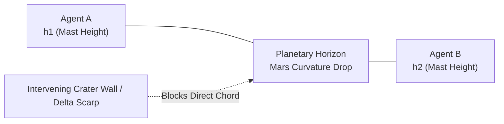

# Planetary Communication Network & Line-of-Sight Modeling

## 1. Physical Propagation & Curvature Model

Radio wave propagation across the Martian surface is constrained by the physical planetary geometry of Mars ($R_{\text{Mars}} = 3396.19\text{ km}$) and local topographical relief.

The geometric line-of-sight horizon distance $d_{\text{LOS}}$ between two elevated antennas of heights $h_1$ and $h_2$ meters is modeled by:

$$d_{\text{LOS}} = \sqrt{2 \cdot R_{\text{Mars}} \cdot h_1} + \sqrt{2 \cdot R_{\text{Mars}} \cdot h_2}$$

### Topographical Ray-Trace Sampling
The `LineOfSightEngine` evaluates line of sight between two surface agents by:
1. Interpolating points along the great-circle chord connecting Agent A and Agent B.
2. Querying MOLA elevation at each chord step.
3. Accounting for Mars curvature drop:
   $$\Delta h_{\text{drop}}(x) = \frac{x \cdot (D - x)}{2 \cdot R_{\text{Mars}}}$$
4. Verifying that the line of sight clears all terrain peaks by at least 1.5 meters.

---

## 2. Multi-Hop Surface Mesh & Rover Relays

When direct surface line of sight is obstructed (e.g. `ROVER-01 SCOUT` descending behind the Jezero Delta scarp), communication rerouting is handled automatically:
- **`ROVER-03 RELAY`** sits atop an elevated ridge ($+45\text{ m}$ relative elevation) with a 5-meter UHF Electra mast.
- The `RelayPlanner` finds the shortest viable multi-hop mesh graph:
  $$\text{ROVER-01 SCOUT} \xrightarrow[\text{UHF 400 MHz}]{\text{Direct}} \text{ROVER-03 RELAY} \xrightarrow[\text{UHF 400 MHz}]{\text{Direct}} \text{ASTRONAUT-01}$$
- When surface links are degraded, links queue telemetry for the next orbital pass.
