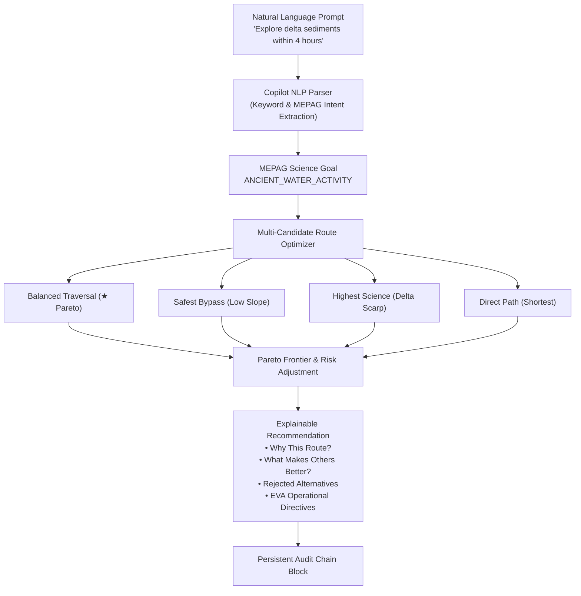

# Martian Map — Copilot Mission Reasoning & Natural Language Parser

## 1. Structured Mission Copilot Architecture

The Mission Copilot is an explainable decision-support agent designed to assist planetary scientists and astronauts in selecting optimal EVA routes. It rejects opaque "black box" generation in favor of a deterministic, factorized reasoning model:

1. **Natural Language Objective Parsing**: Extracts target intent (e.g., ancient water sediments, astrobiology, volcanic basalt), time limits, and risk tolerances.
2. **Deterministic Candidate Synthesis**: Generates 4 distinct traversal profiles (Balanced, Safest, Highest Science, Direct).
3. **Pareto Trade-Off Evaluation**: Identifies non-dominated routes and ranks candidates using risk-adjusted scoring.
4. **Structured Rationale Output**: Emits structured directives, rejected alternative explanations, and uncertainty warnings.

---

## 2. Explainable Rationale Framework

The Copilot explicitly answers two fundamental mission planning questions:

### "Why This Route?"
Explains the positive attributes that make the recommended route dominate the operational trade space:
- High MEPAG relevance for the chosen objective.
- Safe slopes conforming to pressure suit locomotion envelopes ($\le 12^\circ$).
- Sufficient return margin exceeding NASA standard 30-minute reserve buffers.

### "What Would Make Another Route Better?"
Clarifies the specific operational changes required to favor alternative profiles:
- *Highest Science*: Preferred if EVA duration is extended by $+45\text{ min}$ and descent scarp risks are mitigated.
- *Safest Route*: Mandatory if localized dust storms or astronaut suit fatigue occur.
- *Direct Route*: Preferred for uncrewed robotic rovers or rapid emergency returns.

### "Rejected Alternatives"
Explicitly lists why discarded routes failed mission flight rules:
- *Direct Path*: Rejected due to $>22^\circ$ slope grade at crater rim wall.
- *Extended Science*: Rejected due to return margin dropping below 15 minutes.
