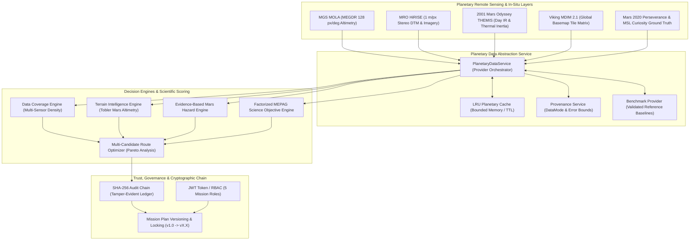

# Ares Frontier — Data Architecture & Planetary Grounding

## 1. Overview & Architectural Philosophy

The **Ares Frontier** data architecture is engineered to provide rigorous, scientifically grounded decision support for Mars surface extravehicular activity (EVA) planning. Rather than treating planetary observations as static assets or synthetic placeholders, the system employs a multi-tiered data provenance model separating:

1. **Observed Physical Evidence** (Orbital remote sensing, in-situ rover logs, calibrated benchmarks)
2. **Derived Engineering Indicators** (Slope vectors, elevation profiles, hazard envelopes)
3. **Multi-Criteria Mission Scoring Rules** (MEPAG objective weighting, multi-attribute utilities, uncertainty penalties)

---

## 2. Tiered Planetary Data Providers

| Dataset | Instrument / Spacecraft | Coverage & Resolution | Primary Provider Module | Data Mode | Error Margin / Baseline |
| :--- | :--- | :--- | :--- | :--- | :--- |
| **MGS MOLA** | Mars Global Surveyor MOLA | Global MEGDR, 128 px/deg (463 m/px) | `molaProvider.ts` | `BENCHMARK` / `CACHED` / `FALLBACK` | $\pm 2.5\text{ m}$ (Benchmark) / $\pm 20.0\text{ m}$ (Fallback) |
| **MRO HiRISE** | Mars Reconnaissance Orbiter | Target Footprints, 0.25–1.0 m DTM | `hiriseProvider.ts` | `BENCHMARK` | High-fidelity microtopography & boulder scale |
| **THEMIS IR** | 2001 Mars Odyssey THEMIS | Regional Daytime IR (100 m/px) | `themisProvider.ts` | `CACHED` | Apparent surface thermal inertia & mantling |
| **Viking MDIM 2.1** | Viking 1 & 2 Orbiters | Global Cartographic Tile Matrix | `USGS Astrogeology WMS` | `LIVE` / `CACHED` | Global visual reference basemap |
| **Rover Ground Truth** | Perseverance (M2020) / Curiosity (MSL) | In-situ outcrops, drill cores, abraded patches | `roverProvider.ts` | `BENCHMARK` | Ground-truth mineralogical & astrobiological logs |

---

## 3. Separation of Real, Benchmark, Fallback, and Heuristic Data

Every telemetry packet and analysis in Ares Frontier carries an explicit `DataMode`:

- **`LIVE`**: Active API or WMS stream directly from NASA / USGS Astrogeology servers.
- **`CACHED`**: Locally cached copy of an authoritative NASA dataset retrieved with bounded TTL.
- **`BENCHMARK`**: High-precision ground-truth observations verified against peer-reviewed landing site documentation (e.g., Jezero delta deposits, Gale Mt. Sharp traverse).
- **`FALLBACK`**: Deterministic areoid mathematical model ($R_{\text{Mars}} = 3396.2\text{ km}$, spherical harmonics) deployed offline when network connectivity is absent.
- **`DEMO`**: Clearly flagged educational simulation scenarios.

---

## 4. Multi-Sensor Data Coverage Intelligence

The `DataCoverageEngine` computes spatial observational density across five independent scientific dimensions:
1. **Vertical Topography**: MOLA altimetry vs. HiRISE stereo DTMs.
2. **High-Resolution Imagery**: Viking regional basemap vs. 0.25 m HiRISE visible stamps.
3. **Surface Thermal Properties**: THEMIS thermal inertia indicating regolith thickness vs. bedrock.
4. **Rover In-Situ Confirmation**: Direct SuperCam/CheMin/PIXL observations within 1.0 km radius.
5. **Astrobiological Target Density**: Number and category of MEPAG priority science targets.

Overall coverage rating is categorized as `HIGH` ($\ge 4$ sensors), `MEDIUM` ($2\text{--}3$ sensors), or `LOW` ($1$ sensor / fallback).
