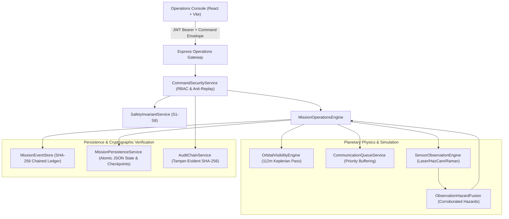

# Phase 5 Architecture — Autonomous Mission Intelligence & Verified Planetary Simulation

## 1. System Mission Statement
Ares Frontier Phase 5 transforms the platform from a multi-agent demonstration into an evidence-driven, reproducible, security-enforced planetary operations simulator. Every telemetry stream, hazard assessment, and orbital pass is governed by explicit physical models, strict server-side role boundaries, and verifiable cryptographic audit trails.

## 2. Core Architectural Pillars

### 2.1 Multi-Agent Autonomous Roster
The system orchestrates a heterogeneous planetary team deployed to Jezero Crater:
1. **Astronaut Commander Vance (`agent-astronaut-01`)**: Human crew explorer, metabolic load tracking, autonomous health corridor protection.
2. **Ares Scout Rover (`agent-rover-01`)**: Forward reconnaissance, stereo hazcams, dual laser altimeter, high mobility (4.8 km/h).
3. **Ares Science Rover (`agent-rover-02`)**: In-situ astrobiology, Raman spectrometer, robotic arm, thermal infrared sensor.
4. **Ares Relay Rover (`agent-rover-03`)**: High-gain communication relay, 5.0m antenna mast providing 12 km line-of-sight coverage across Jezero crater floor.
5. **Mars Reconnaissance Orbiter (`agent-orbiter-01`)**: High-bandwidth relay operating on deterministic 112-minute orbital pass cycles.

### 2.2 Truthful Planetary Data Provenance
Data in Phase 5 is categorized into transparent modes:
- `REAL_DATA`: Cataloged NASA/USGS coordinates and historical landing benchmarks.
- `BENCHMARK`: MOLA MEGDR 128 px/deg elevation profiles.
- `SIMULATED`: Deterministic synthetic observations with explicitly calculated Gaussian noise.
- `DERIVED`: Multi-sensor inverse-variance fusions and orbital pass geometries.
- `HEURISTIC`: Decision thresholds and pathing priorities.

Under Safety Invariant S6, any synthetic observation attempting to claim `LIVE` status is immediately rejected.
