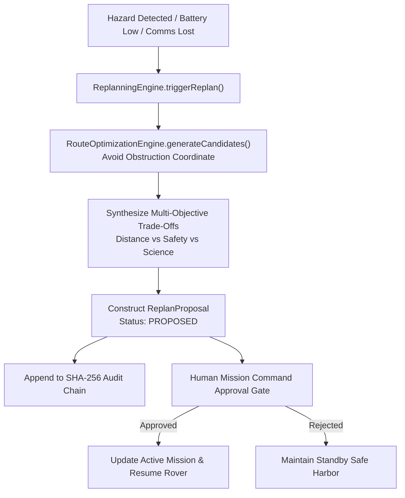

# Autonomous Replanning & Human-in-the-Loop Governance

## 1. Automated Replanning Trigger Engine

Planetary field missions are dynamic. When hazards, battery anomalies, or comm losses occur, the `ReplanningEngine` executes an automated proposal cycle:

---

## 2. Quantitative Trade-Off Synthesis

When proposing an alternative route, the engine presents explicit trade-off metrics to Flight Directors:
- **$\Delta\text{ Distance}$**: Additional kilometers required for the detour.
- **$\Delta\text{ Duration}$**: Additional minutes of rover traverse time.
- **$\Delta\text{ Safety Score}$**: Quantitative safety increase from bypassing high-slope scarp.
- **$\Delta\text{ Science Score}$**: Scientific preservation score.
- **$\Delta\text{ Risk-Adjusted Score}$**: Comprehensive risk-weighted margin.

---

## 3. Human-in-the-Loop Mission Governance

In compliance with NASA flight safety principles, the system prohibits fully autonomous route rewrites for safety-critical missions without Mission Command authorization:
1. Replanning proposals remain in `PROPOSED` state.
2. The Operations Copilot provides plain-language justification and directives.
3. Flight Directors or Mission Commanders authenticate via JWT credentials to call `POST /api/operations/replan/:id/approve`.
4. The approved plan version is committed to the immutable audit chain.
