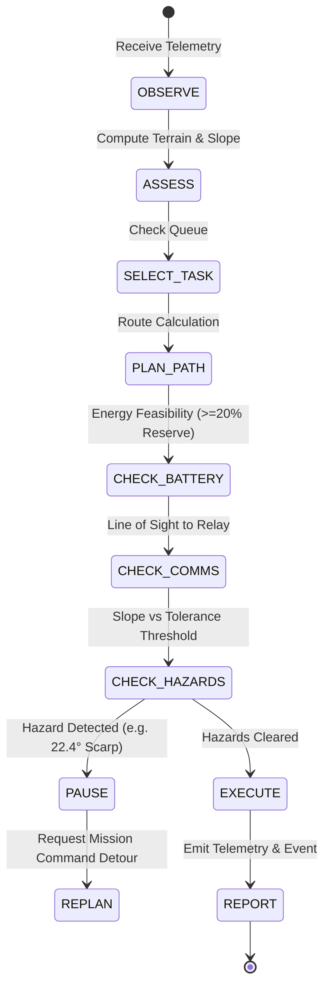

# Autonomous Rover Decision-Making & Control Loop

## 1. Autonomous Control Architecture

Ares Frontier's autonomous rover decision engine implements a 9-stage closed-loop operational cycle:

$$\text{OBSERVE} \to \text{ASSESS} \to \text{SELECT TASK} \to \text{PLAN PATH} \to \text{CHECK BATTERY} \to \text{CHECK COMMS} \to \text{CHECK HAZARDS} \to \text{EXECUTE / PAUSE} \to \text{REPORT}$$

---

## 2. Safe Return Energy Feasibility

Every task assignment enforces physical energy constraints based on rover battery capacity:

$$\text{Energy Required} = D \times E_{\text{consumption}} \times (1 + \text{Incline Penalty})$$

$$\text{Safe Return Feasible} \iff E_{\text{current}} - \text{Energy Required} \ge E_{\text{reserve}} \quad (20\% \text{ of nominal capacity})$$

If the target distance exceeds battery margin or violates the mandatory 20% safe-return reserve, the task planner immediately rejects the task with HTTP 422 `TASK_UNFEASIBLE` and logs a warning event.

---

## 3. Autonomous Hazard Thresholds

Each rover class maintains calibrated slope and roughness thresholds:
- **`ROVER-01 SCOUT`**: Maximum slope tolerance = $20.0^\circ$. High-speed chassis with active rocker-bogie articulation.
- **`ROVER-02 SCIENCE`**: Maximum slope tolerance = $14.0^\circ$. Heavy payload arm and high center-of-mass require gentler terrain gradients.
- **`ROVER-03 RELAY`**: Maximum slope tolerance = $15.0^\circ$. Elevated mast antenna must maintain vertical stability.

When measured terrain slope exceeds the agent's threshold (such as the 22.4° delta scarp), the rover executes an emergency autonomous pause, reports telemetry over UHF relay, and enters `STANDBY_FOR_REPLAN` status.
