# MARTIAN MAP — EXISTING ARCHITECTURE MAP

**Audit Date**: November 12, 2026  
**Auditor**: Antigravity Technical Audit Agent  
**Repository**: `martian-map`  

---

## 1. System Architecture Diagram

```mermaid
graph TD
    subgraph Frontend["Frontend Client (React 18 + Vite + Tailwind + Leaflet)"]
        UI_Nav["Navbar & ThemeContext"]
        UI_Map["MapPage & MarsMap (2D Leaflet)"]
        UI_Route["RoutePlanner & ElevationProfileChart"]
        UI_Mission["MissionPage & AssessmentCard"]
        UI_Ops["OperationsPage (Fleet, Comms, Queue)"]
        UI_Replay["MissionReplayPage (Playback Scrubber)"]
        UI_Analytics["MissionAnalyticsPage (KPIs & Invariants)"]
        UI_Demo["JudgingDemoPage (Scenario Launchers)"]
        UI_Badges["DataConfidenceBadge & ProvenancePanel"]
    end

    subgraph API_Gateway["Express API Gateway (src/app.ts & routes/api.ts)"]
        MW_Sec["Security Middleware (Helmet, CORS, RateLimit, JWT, Nonce)"]
        Ctrl_Loc["locationController"]
        Ctrl_Terrain["terrainController"]
        Ctrl_Science["scienceController"]
        Ctrl_Route["routeController"]
        Ctrl_Mission["missionController"]
        Ctrl_Assess["assessmentController"]
        Ctrl_Intel["intelligenceController"]
        Ctrl_Ops["operationsController"]
        Ctrl_Data["dataController"]
    end

    subgraph Core_Services["Core Planetary Services"]
        Svc_Mola["marsDataService & molaProvider"]
        Svc_Terrain["terrainEngine & slopeCalculation"]
        Svc_Hazard["hazardEngine & hazardFusion"]
        Svc_SciObj["scienceObjectiveEngine (MEPAG)"]
        Svc_RouteOpt["routeOptimizationEngine (Pareto 4-Profile)"]
        Svc_Reasoning["missionReasoningService (Keyword Copilot)"]
        Svc_Prov["provenanceService & decisionLineageService"]
        Svc_Safety["safetyInvariantService (S1-S8)"]
    end

    subgraph Operations_Services["Field Operations & Digital Twin"]
        Ops_Fleet["agentRegistry & agentStateStore"]
        Ops_Task["agentTaskPlanner & multiAgentCoordinator"]
        Ops_Comms["communicationEngine & orbitalVisibilityEngine"]
        Ops_Queue["communicationQueueService (Priority Buffer)"]
        Ops_Sim["whatIfSimulationEngine & monteCarloEngine"]
        Ops_Fail["failureInjectionEngine"]
        Ops_Replay["missionReplayEngine & replayStateManager"]
    end

    subgraph Adapters["Adapters & External Interfaces"]
        Adapt_ML["mlEngineAdapter (HTTP -> :8000 / Heuristic Fallback)"]
        Adapt_Sci["scienceEngineAdapter (HTTP -> :8001 / Rule Fallback)"]
        Adapt_NASA["benchmarkData (Hardcoded 5 sites, 6 targets)"]
    end

    subgraph Persistence["Storage & State Persistence"]
        DB_Schema["schema.sql (PostgreSQL / PostGIS - Offline DDL)"]
        Store_Memory["missionRepository (In-Memory Map)"]
        Store_Disk["missionPersistenceService & missionEventStore (backend/data/*.json)"]
        Store_Audit["auditChainService (data/audit_chain.json)"]
    end

    UI_Map -->|HTTP REST| Ctrl_Loc
    UI_Map -->|HTTP REST| Ctrl_Terrain
    UI_Route -->|HTTP REST| Ctrl_Route
    UI_Mission -->|HTTP REST| Ctrl_Assess
    UI_Ops -->|HTTP REST| Ctrl_Ops
    UI_Replay -->|HTTP REST| Ctrl_Ops
    UI_Analytics -->|HTTP REST| Ctrl_Ops

    Ctrl_Assess --> Adapt_ML
    Ctrl_Science --> Adapt_Sci
    Ctrl_Loc --> Svc_Mola
    Ctrl_Terrain --> Svc_Terrain
    Ctrl_Route --> Svc_RouteOpt
    Ctrl_Intel --> Svc_Reasoning
    Ctrl_Intel --> Svc_Hazard
    Ctrl_Ops --> Ops_Fleet
    Ctrl_Ops --> Ops_Comms
    Ctrl_Ops --> Ops_Sim
    Ctrl_Ops --> Ops_Replay

    Adapt_ML -.->|DISCONNECTED| Ext_ML["External ML Microservice (:8000)"]
    Adapt_Sci -.->|DISCONNECTED| Ext_Sci["External Science Server (:8001)"]
    Svc_Mola --> Adapt_NASA
    Svc_Hazard --> Svc_Prov
    Ops_Fleet --> Store_Disk
    Ops_Replay --> Store_Disk
    MW_Sec --> Store_Audit
```



---

## 2. Component & Module Breakdown

### 2.1 Fully Implemented Modules
These modules are complete, tested, and demonstrably operational:
1. **Security & Cryptographic Audit Ledger**:
   - `backend/src/services/security/auditChainService.ts`
   - `backend/src/services/security/commandSecurityService.ts`
   - `backend/src/middleware/securityMiddleware.ts`
   - Implements HMAC-SHA256 chained hashing, nonce consumption with 300s TTL, and 5-tier RBAC (`MISSION_COMMAND`, `SCIENCE_OFFICER`, `ASTRONAUT`, `ANALYST`, `VIEWER`).
2. **Safety Invariants Engine (S1–S8)**:
   - `backend/src/services/safety/safetyInvariantService.ts`
   - `backend/src/services/validation/missionValidationEngine.ts`
   - Automated rule gating verifying battery reserves (>= 20%), route hazard thresholds, human authorization, event immutability, lost link routing blocks, honest provenance, and token freshness.
3. **Orbital Visibility & Pass Geometry**:
   - `backend/src/services/comms/orbitalVisibilityEngine.ts`
   - 112-minute orbital pass cycle with 20-minute active window calculations based on MRO Electra UHF specs.
4. **Data Provenance & Trust Modeling**:
   - `backend/src/services/planetary/provenanceService.ts`
   - Standardized `DataProvenance` contract, 5 operational data tiers (`BENCHMARK`, `CACHED`, `LIVE`, `FALLBACK/DERIVED`, `SIMULATED`), and UI badge representation.
5. **Decision Lineage Graph Construction**:
   - `backend/src/services/intelligence/decisionLineageService.ts`
   - Causal 7-stage explanation chain linking sensor observations to execution.
6. **2D Mars GIS Engine**:
   - `frontend/src/components/MarsMap.tsx`
   - Equirectangular coordinate rendering, Viking MDIM 2.1, MOLA shaded relief, and THEMIS IR tiles with custom reticle HUD.

### 2.2 Partially Implemented Modules
These modules exist and operate, but rely on simplified, heuristic, or incomplete logic:
1. **Route Optimization Engine (`routeOptimizationEngine.ts`)**:
   - Computes 4 candidate profiles and Pareto frontier, but generates routes via fixed coordinate offsets rather than dynamic pathfinding over elevation grids.
2. **Terrain & Elevation Engine (`marsDataService.ts`, `terrainEngine.ts`)**:
   - Evaluates slope and terrain roughness, but computes elevations using a synthetic trigonometric function (`estimateMolaElevation`) rather than reading actual MOLA DEM raster files.
3. **Hazard Engine & Hazard Fusion (`hazardEngine.ts`, `hazardFusion.ts`)**:
   - Evaluates slope and catalog hazards, fusing HazCam and Laser altimetry; lacks non-terrain hazards (communication blackout zones, battery cutoff points, radiation).
4. **Communication Network & Queue (`communicationEngine.ts`, `communicationQueueService.ts`)**:
   - Mars chord ray-tracing and priority packet queue, but lacks standard DTN bundle protocols and multi-hop mesh routing.
5. **Multi-Agent Operations (`agentRegistry.ts`, `multiAgentCoordinator.ts`)**:
   - Fixed roster of 5 agents and 3 queue items; task allocation is manual rather than algorithmic.
6. **Digital Twin Replay (`missionReplayEngine.ts`, `replayStateManager.ts`)**:
   - Replays stored events chronologically; lacks continuous bidirectional telemetry synchronization with live assets.
7. **Mission Analytics (`missionAnalyticsService.ts`)**:
   - Computes 7-factor health score (89/100) for `MARSWALK-001`, but lacks multi-plan comparison and fleet-wide KPI aggregation.
8. **Mission Reporting (`MissionPage.tsx`)**:
   - Client-side JSON export and browser print CSS; lacks server-side PDF dossier compilation.

### 2.3 Placeholder & Mock Modules
These modules contain interfaces or fallback code with no underlying real backend service:
1. **External AI/ML Microservice**:
   - `ml/README.md` is a stub document. `mlEngineAdapter.ts` falls back to `calculateBaselineAssessment()`.
2. **External Science Rules Service**:
   - `science/README.md` is a stub document. `scienceEngineAdapter.ts` falls back to `evaluatePlanetaryGeology()`.
3. **Database Schema (`schema.sql`)**:
   - DDL definitions for PostgreSQL/PostGIS exist, but the application runs purely in-memory and on flat JSON files. No PostgreSQL client library is installed.
4. **What-If Simulation (`whatIfSimulationEngine.ts`)**:
   - Returns hardcoded canned metric tables for `IGNORE_HAZARD`, `CONSERVATIVE_STANDBY`, etc., without dynamic terrain simulation.
5. **Monte Carlo Simulation (`monteCarloEngine.ts`)**:
   - Samples Gaussian distributions around hardcoded numbers (78% battery, 42 min duration) rather than simulating stochastic physics across waypoints.
6. **Mission Copilot (`missionReasoningService.ts`)**:
   - Regex string matching (`if (q.includes("hazard"))`) returning pre-scripted responses.

---

## 3. Data Flow Analysis

### 3.1 Route Planning & Evaluation Flow
```
User clicks on MapPage
  -> RoutePlanner adds waypoints
  -> POST /api/routes
  -> missionEngine.generateRoute()
      -> marsCoordinates.calculateMarsDistanceKm()
      -> marsDataService.estimateMolaElevation() [Analytical Math]
      -> calculateSlopeDegrees()
  -> Route stored in missionRepository [In-Memory Map]
  -> POST /api/assessment
  -> assessmentController
      -> mlEngineAdapter.assessMission()
          -> [ENABLE_ML_SERVICE=false]
          -> calculateBaselineAssessment() [Deterministic Heuristic]
  -> Returns MissionAssessment with safetyScore, scienceScore, accessibilityScore
```

### 3.2 Copilot Multi-Objective Candidate Optimization Flow
```
User inputs prompt in Copilot UI ("Plan a 3-hour science mission to investigate ancient lake beds")
  -> POST /api/copilot/mission-plan
  -> intelligenceController.copilotMissionPlan()
      -> missionReasoningService.parseNaturalLanguagePrompt() [Keyword Matching]
      -> routeOptimizationEngine.generateCandidates()
          -> scienceObjectiveEngine.rankTargetsForObjective()
          -> Generates 4 route profiles via fixed coordinate offsets
          -> hazardEngine.assessRouteHazards()
          -> scienceObjectiveEngine.calculateRouteScienceScore()
          -> dataCoverageEngine.assessRouteCoverage()
          -> computeParetoFrontier() [Non-dominated sorting]
      -> missionReasoningService.generateRecommendation() [Template String Interpolation]
  -> Returns 4 RouteCandidates + Pareto status + Structured Copilot Explanation
```

### 3.3 Field Operations & Replan Flow
```
Live Operations (/operations)
  -> GET /api/operations/state
  -> operationsController.getOperationsState()
      -> AgentRegistry.getAllAgents()
      -> CommunicationEngine.evaluateNetwork() [Chord Ray-Tracing]
      -> MissionTimelineEngine.getTimeline()
      -> MultiAgentCoordinator.getScienceQueue()
  -> Scout Rover encounters slope hazard in demo
  -> POST /api/operations/replan
  -> ReplanningEngine.createProposal()
      -> Calculates detour route avoiding hazard circle
      -> Evaluates battery and comms feasibility
  -> POST /api/operations/replan/:id/approve (Requires MISSION_COMMAND JWT role)
  -> ReplanningEngine.approveReplan()
      -> Updates agent route and status to EXECUTING
      -> auditChainService.addBlock() [Appends SHA-256 block]
      -> MissionEventStore.appendEvent() [Appends event to ledger]
      -> MissionPersistenceService.saveState() [Atomic write to disk]
```

---

## 4. Architectural Inconsistencies & Disconnections

1. **Disconnected ML & Science Microservices**:
   - Both `mlEngineAdapter` and `scienceEngineAdapter` have active `fetch()` code pointing to ports 8000 and 8001, but the target services do not exist in the repository. Both adapters permanently run in fallback heuristic mode.
2. **Dual Persistence Models**:
   - `missionRepository.ts` stores routes and missions in volatile in-memory Maps (`private routes: Map<string, MarsRoute>`).
   - In contrast, `MissionPersistenceService.ts` and `MissionEventStore.ts` store operations state, agents, and events in flat JSON files on disk (`backend/data/`).
   - If the server restarts, routes saved via `POST /api/routes` are lost (except the default seed), while agents and events survive in `backend/data/`.
3. **Disconnection Between Route Planning and Multi-Agent Fleet**:
   - The route planner on `/map` creates routes for generic EVA traverses.
   - The operations fleet on `/operations` uses pre-seeded agents (`ROVER-01`, `ASTRONAUT-01`) whose initial tasks and waypoints are separate from the routes created on the map.
4. **Hardcoded Benchmark vs. Arbitrary Coordinate Degradation**:
   - Within 25 km of the 5 benchmark sites, the system returns curated NASA metadata.
   - Outside those sites, the system generates synthetic data marked `isMockData: true`, but science targets drop to zero and elevation relies on the crustal dichotomy math formula.
5. **No Unified Global State in Frontend**:
   - Each page (`MapPage`, `MissionPage`, `OperationsPage`, `MissionReplayPage`) fetches its own slice of state independently via `useEffect` calls. There is no shared client-side store (Zustand, Redux, or comprehensive Context) synchronizing mission data between views.
