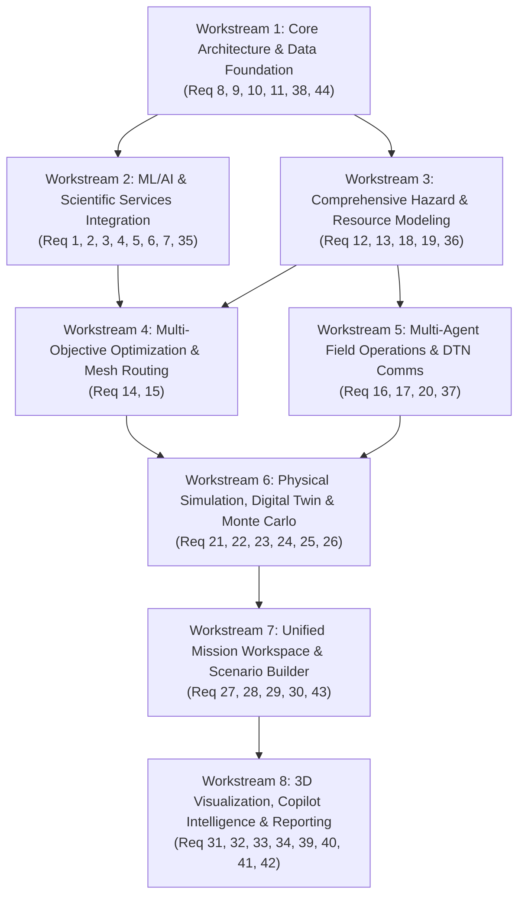

# MARTIAN MAP — IMPLEMENTATION ROADMAP

**Audit Date**: November 12, 2026  
**Auditor**: Antigravity Technical Audit Agent  
**Repository**: `martian-map`  

---

## 1. Roadmap Overview & Strategic Phasing

The 44 requirements are organized into 8 sequential workstreams ordered by architectural dependencies. Fundamental data layers, persistence, and service adapters must be established before downstream optimization, simulation, and user-facing features.

---

## 2. Workstream Breakdown

### Workstream 1: Core Architecture, Unified State & Data Foundation
- **Requirements Covered**: 8, 9, 10, 11, 38, 44
- **Category**: Integration Work & Scientific Data Expansion
- **Existing Implementation to Preserve**:
  - `ProvenanceService.ts` and `decisionLineageService.ts` (strict dataset attribution).
  - `OperationalDataModeBadge.tsx` (5-tier data classification compliance).
  - `schema.sql` PostgreSQL DDL schema definitions.
- **Remaining Development**:
  1. Unify fragmented state stores (`missionRepository`, `AgentStateStore`, `MissionEventStore`) into a centralized `MissionStateCoordinator`.
  2. Implement local GeoTIFF / DEM raster reader or preprocessed elevation tile sampling in `data/processed/` to replace the analytical trigonometric approximation.
  3. Add SQLite / Embedded PostgreSQL persistence option to eliminate volatile in-memory Maps.
  4. Ingest global Mars datasets (CRISM mineralogy, SWIM ice resources, TES thermal inertia).
- **Technical Dependencies**: Node.js filesystem, GeoTIFF parsing library (e.g. `geotiff.js`).
- **Critical Blockers**: None.
- **Recommended Sequence**: Step 1.1: Unify state stores; Step 1.2: Add SQLite/file persistence for routes; Step 1.3: Add raster DEM sampling; Step 1.4: Ingest mineralogy/ice data slices.
- **Acceptance Criteria**:
  - Routes and missions persist across server restarts in unified storage.
  - Elevation lookups at arbitrary Mars coordinates read calibrated DEM rasters with demonstrable ±2m precision.
- **Testing Requirements**: Unit tests for persistence fail-over; raster coordinate sampling accuracy tests.

---

### Workstream 2: ML/AI & Scientific Services Integration
- **Requirements Covered**: 1, 2, 3, 4, 5, 6, 7, 35
- **Category**: ML/AI Development & Integration Work
- **Existing Implementation to Preserve**:
  - Interface contracts in `ml/README.md` and `science/README.md`.
  - Service adapters `mlEngineAdapter.ts` and `scienceEngineAdapter.ts` with error-handling fallback logic.
  - `scienceObjectiveEngine.ts` MEPAG objective mapping.
- **Remaining Development**:
  1. Build a lightweight Python FastAPI microservice in `ml/` implementing `/api/v1/assess` with Scikit-learn/PyTorch hazard & route safety models.
  2. Build a Python/Node.js planetary geology service in `science/` providing `/api/v1/science/assess`.
  3. Expand science targets catalog from 6 to 50+ across Jezero, Gale, Olympus Mons, Valles Marineris, and Meridiani Planum.
  4. Expand mission objectives to include ISRU water-ice mining, base infrastructure, and sample return caching.
- **Technical Dependencies**: Python 3.11+, FastAPI, Uvicorn, Scikit-learn, ONNX Runtime.
- **Critical Blockers**: Python environment configuration in deployment containers.
- **Recommended Sequence**: Step 2.1: Implement `science/` service and expand targets; Step 2.2: Implement `ml/` inference microservice; Step 2.3: Connect adapters and enable environment flags.
- **Acceptance Criteria**:
  - Backend successfully receives live predictions from `http://localhost:8000/api/v1/assess` and `http://localhost:8001/api/v1/science/assess`.
  - System automatically switches scoring badge to `model-generated` without fallback warnings.
- **Testing Requirements**: Contract tests for microservice schemas; integration tests verifying adapter dispatch and live inference scoring.

---

### Workstream 3: Comprehensive Hazard & Resource Modeling
- **Requirements Covered**: 12, 13, 18, 19, 36
- **Category**: Scientific Data Expansion & New Functionality
- **Existing Implementation to Preserve**:
  - `hazardEngine.ts` catalog hazards and slope incline detection.
  - `hazardFusion.ts` dual-sensor corroboration.
  - `safetyInvariantService.ts` S1 20% battery reserve rule.
- **Remaining Development**:
  1. Add communication shadow zones and non-return battery cutoff points to `hazardEngine.ts`.
  2. Implement environmental hazards (solar dust storm opacity, nocturnal cryogenic thermal stress).
  3. Add consumable mass tracking: sample collection tube capacity, onboard memory buffer limits, suit oxygen/water budgets.
  4. Model slope-dependent motor current draw and diurnal solar panel energy generation.
- **Technical Dependencies**: Workstream 1 (elevation raster for shadow ray tracing).
- **Critical Blockers**: None.
- **Recommended Sequence**: Step 3.1: Add non-terrain hazard types; Step 3.2: Implement energy generation/consumption models; Step 3.3: Implement consumables budgets in mission planning.
- **Acceptance Criteria**:
  - Routes entering communication shadows or exceeding round-trip battery reserves trigger explicit hazard warnings.
  - Battery state-of-charge profile accurately reflects uphill/downhill traversal energetic cost.
- **Testing Requirements**: Invariant tests validating battery and consumables depletion triggers.

---

### Workstream 4: Multi-Objective Route Optimization & Mesh Routing
- **Requirements Covered**: 14, 15
- **Category**: Mission Optimization
- **Existing Implementation to Preserve**:
  - `routeOptimizationEngine.ts` candidate evaluation framework and Pareto non-domination algorithm.
- **Remaining Development**:
  1. Replace hardcoded waypoint offsets with an authentic graph search algorithm (A* or Dijkstra over an elevation grid).
  2. Incorporate communication availability, battery expenditure, scientific ROI, and evidence uncertainty into the objective cost function.
  3. Allow custom weighting of optimization objectives (e.g. 70% science, 20% safety, 10% speed).
- **Technical Dependencies**: Workstream 1 (raster DEM), Workstream 3 (hazard and energy models).
- **Critical Blockers**: Pathfinding computation performance over large grids (requires quadtree or downsampled tile graph).
- **Recommended Sequence**: Step 4.1: Implement grid-based A* pathfinder; Step 4.2: Integrate multi-factor cost function; Step 4.3: Expose dynamic objective weights.
- **Acceptance Criteria**:
  - Generated paths navigate dynamically around scarps, boulders, and communication shadows without pre-baked offsets.
  - Pareto frontier accurately selects non-dominated routes balancing science and risk.
- **Testing Requirements**: Benchmark tests verifying generated paths strictly avoid forbidden hazard polygons.

---

### Workstream 5: Multi-Agent Field Operations & DTN Comms
- **Requirements Covered**: 16, 17, 20, 37
- **Category**: Simulation & New Functionality
- **Existing Implementation to Preserve**:
  - `agentRegistry.ts` agent definitions and telemetry schemas.
  - `orbitalVisibilityEngine.ts` Keplerian geometry calculations.
  - `communicationQueueService.ts` priority buffer management.
- **Remaining Development**:
  1. Implement automated task allocation using auction algorithms / market-based bidding matching agent capabilities to science queue items.
  2. Add multi-hop mesh routing over the active line-of-sight graph.
  3. Implement standard Delay-Tolerant Networking (DTN) bundle simulation with storage-and-forward mechanics.
  4. Model capability degradation (wheel slip wear, spectrometer dust contamination).
- **Technical Dependencies**: Workstream 3 (resource modeling).
- **Critical Blockers**: None.
- **Recommended Sequence**: Step 5.1: Implement DTN mesh routing; Step 5.2: Build automated auction-based task allocator; Step 5.3: Add collaborative behaviors.
- **Acceptance Criteria**:
  - Telemetry packets automatically route through intermediate relay rovers when direct line of sight to base is obstructed.
  - Science tasks are automatically allocated to the optimal capable agent based on proximity and battery margin.
- **Testing Requirements**: Simulation tests verifying multi-hop packet delivery and task allocation optimality.

---

### Workstream 6: Physical Simulation, Digital Twin & Monte Carlo
- **Requirements Covered**: 21, 22, 23, 24, 25, 26
- **Category**: Simulation and Digital Twin
- **Existing Implementation to Preserve**:
  - `failureInjectionEngine.ts` (10 deterministic failure modes and audit logging).
  - `simulationComparator.ts` (structured metrics diff).
  - Seeded PRNG framework in `monteCarloEngine.ts`.
- **Remaining Development**:
  1. Replace canned What-If diff tables with dynamic forward step-simulation executing alternative decisions over the terrain model.
  2. Upgrade Monte Carlo engine to run stochastic waypoint-by-waypoint traversal runs with slip variance, wind drift, and obstacle density.
  3. Expand Digital Twin to support live forward projections alongside historical event playback.
  4. Expose all uncertainty parameters (DEM noise sigma, sensor error, weather variance) via API and UI.
- **Technical Dependencies**: Workstream 3 (energy/hazards), Workstream 4 (route pathfinding).
- **Critical Blockers**: Monte Carlo execution speed (keep 100 iterations under 1.5 seconds via vectorized math).
- **Recommended Sequence**: Step 6.1: Dynamic What-If forward simulator; Step 6.2: Waypoint-level Monte Carlo traversal; Step 6.3: Digital Twin live synchronization.
- **Acceptance Criteria**:
  - Monte Carlo distributions reflect actual route terrain difficulty rather than hardcoded baselines.
  - What-If simulations produce dynamically calculated deltas based on injected failure timing and detour choices.
- **Testing Requirements**: Reproducibility tests verifying identical seeds yield identical Monte Carlo percentile curves.

---

### Workstream 7: Unified Mission Workspace & Scenario Builder
- **Requirements Covered**: 27, 28, 29, 30, 43
- **Category**: User Experience & New Functionality
- **Existing Implementation to Preserve**:
  - Redesigned Atlas Intelligence UI components and styling.
  - Interactive map layers and reticle HUD.
  - Existing individual pages as deep-linkable views.
- **Remaining Development**:
  1. Build a unified Mission Planning Workspace combining map, route optimizer, fleet status, and simulation drawer in a single dockable interface.
  2. Implement an end-to-end 7-stage guided mission stepper (Objective $\to$ Target $\to$ Route $\to$ Hazard $\to$ Resource $\to$ Comms $\to$ Simulation).
  3. Build an interactive Mission Scenario Builder enabling operators to author, configure, save, and launch custom missions.
  4. Parameterize all scenario endpoints to eliminate hardcoded presets.
- **Technical Dependencies**: Workstream 1 (unified state), Workstream 6 (dynamic simulation).
- **Critical Blockers**: None.
- **Recommended Sequence**: Step 7.1: Scenario Builder backend CRUD and UI; Step 7.2: Unified Workspace layout; Step 7.3: 7-stage guided stepper.
- **Acceptance Criteria**:
  - Operator can create a completely new custom scenario from scratch and run it through the end-to-end mission pipeline without touching code.
  - State changes in route planning immediately reflect across operations and simulation panels without page reloads.
- **Testing Requirements**: End-to-end browser user journey tests from scenario creation to simulation report.

---

### Workstream 8: 3D Visualization, Copilot Intelligence & Reporting
- **Requirements Covered**: 31, 32, 33, 34, 39, 40, 41, 42
- **Category**: Visualization, Analytics, Copilot and Reporting
- **Existing Implementation to Preserve**:
  - 2D Leaflet map functionality and raster layer controls.
  - Structured Copilot response schema (`StructuredCopilotResponse`).
  - Mission analytics health score breakdown (89/100).
- **Remaining Development**:
  1. Integrate Three.js / WebGL to provide a 3D Mars terrain viewer with 3D rover models, elevation ribbons, hazard cylinders, and line-of-sight ray casting.
  2. Upgrade Mission Copilot with LLM inference (via Gemini API or local Ollama) and function calling tools (`addWaypoint`, `assignTask`, `runSimulation`).
  3. Expand mission analytics with aerospace KPIs (Science ROI per Watt-hour, MTBF, communication duty cycle) and multi-plan comparison.
  4. Build server-side PDF mission report dossier generator containing full telemetry, Gantt charts, Monte Carlo curves, and cryptographic signatures.
- **Technical Dependencies**: Three.js / React Three Fiber, LLM API credentials or local model runner, PDFKit or Puppeteer.
- **Critical Blockers**: 3D rendering performance on low-end client hardware (provide fallback toggle to 2D Leaflet).
- **Recommended Sequence**: Step 8.1: Server-side PDF report dossier; Step 8.2: Copilot LLM & tool-calling integration; Step 8.3: 3D terrain viewer component; Step 8.4: Advanced multi-plan analytics.
- **Acceptance Criteria**:
  - User can toggle between 2D Leaflet and 3D terrain view with smooth camera controls and 3D asset rendering.
  - Copilot can interpret natural language commands and execute real planning operations on the workspace.
  - Downloaded PDF report contains complete, audit-verified mission dossiers.
- **Testing Requirements**: Visual regression tests for 3D canvas; tool-calling validation for Copilot commands; PDF generation integration tests.
